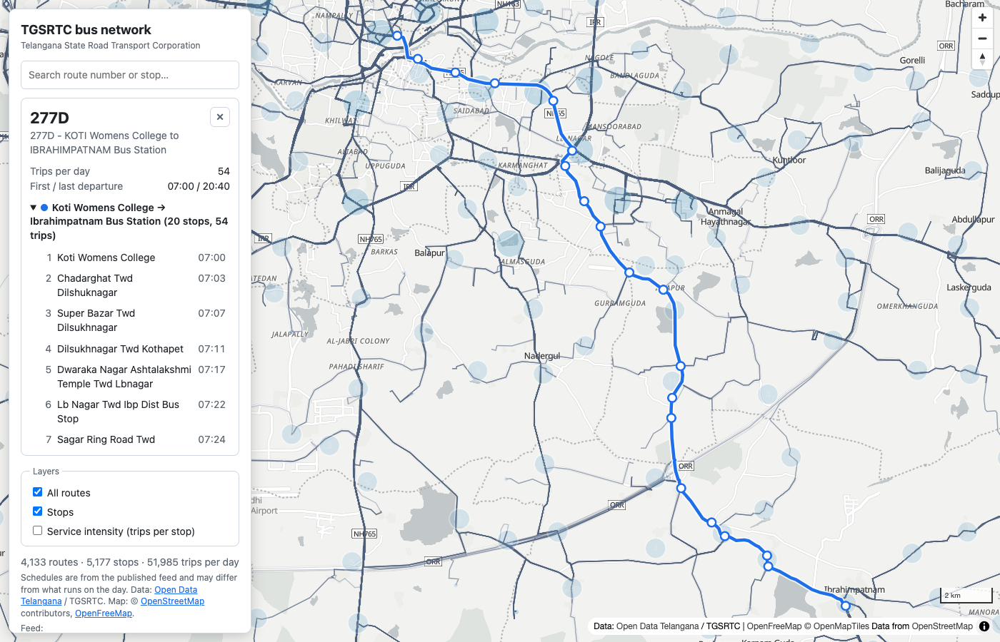
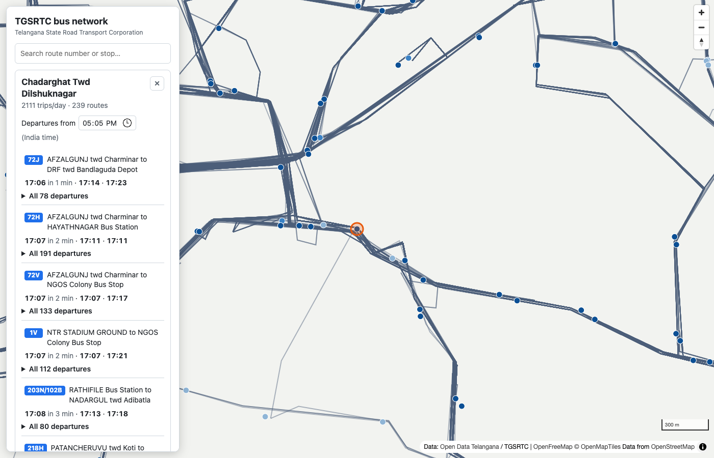
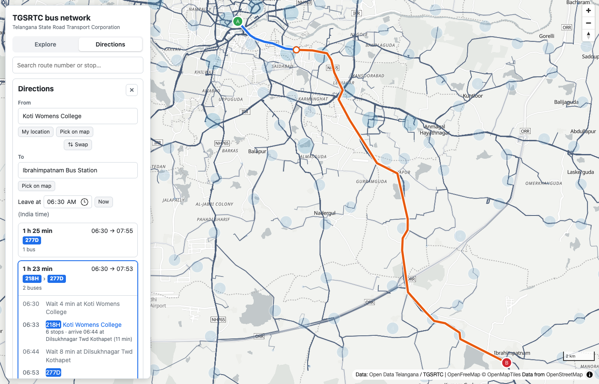
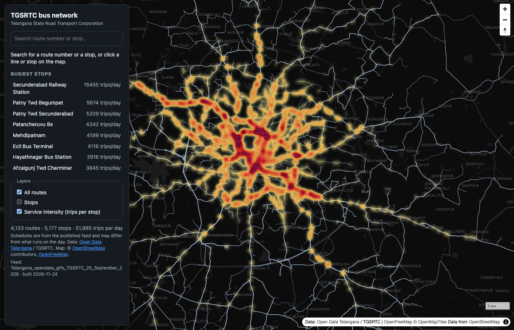

# tgbus

[](https://github.com/jitinchekka2/tgbus/actions/workflows/ci.yml)
[](https://github.com/jitinchekka2/tgbus/actions/workflows/pages.yml)
[](LICENSE)

An open-source explorer for **Telangana State Road Transport Corporation (TGSRTC)** bus
data. It turns the official GTFS feed into a fast, static website: browse every route
and stop on a map, search by route number or place, and see when buses leave a stop.

**Live demo: https://jitinchekka2.github.io/tgbus/**
(try [route 277D](https://jitinchekka2.github.io/tgbus/#/route/00OqzfuB))

| Route | Stop timetable |
|---|---|
|  |  |

**Directions**: plan a bus journey from A to B, with transfers, entirely in your browser.





## Features
- **Whole network on one map**: 4,100+ routes and 5,100+ stops, with clustering and a
  service-intensity heat layer (trips per stop).
- **Route pages**: line drawn per direction, numbered stops with times, trips per day,
  first and last departure.
- **Stop pages**: next departures per route (soonest first, in India time), all departures
  for the day, adjustable start time.
- **Search**: route number or stop name, keyboard-accessible.
- **Directions**: pick a start and destination (stop name, your location, or a point on the
  map), a departure time, and get the best journeys by number of buses, with walking and
  waiting shown step by step and drawn on the map. Works after midnight and across the night gap.
- **Shareable links**: `#/route/<id>`, `#/stop/<id>` and `#/plan/<from>/<to>/<time>`.
- **Static output**: no server to run; works from any path (for example GitHub Pages). The
  journey planner runs in the visitor's browser as WebAssembly.
- Light and dark themes, mobile layout.

## Quick start
You need [Go](https://go.dev/dl/) (version in `go.mod`) and the GTFS feed.

1. Download the **TGSRTC GTFS** feed from [Open Data Telangana](https://data.telangana.gov.in/)
   and unzip it, so you have a folder containing `routes.txt`, `trips.txt`, `stops.txt`,
   `stop_times.txt` and `shapes.txt`. The feed is not in this repository (it is 150+ MB).
2. Build and preview (needs `make`; see below if you do not have it):

```sh
make site FEED=path/to/feed      # writes ./dist
make serve                       # open http://localhost:8080
```

Building the full feed takes a few seconds and writes about 9,300 small files
(~58 MB). A first page load transfers roughly 0.7 MB gzipped; opening Directions loads the
planner once (about 1.8 MB gzipped: 1.25 MB of WebAssembly plus a 0.56 MB timetable).

Without `make`, the same steps by hand:

```sh
go run ./cmd/tgbus build -feed path/to/feed -out dist
GOOS=js GOARCH=wasm go build -trimpath -ldflags="-s -w" -o dist/planner.wasm ./cmd/planner-wasm
cp "$(go env GOROOT)/lib/wasm/wasm_exec.js" dist/
go run ./cmd/tgbus serve -dir dist
```

A site built without the last two steps still works; Directions then says the planner is not
part of that build.

Other commands:

```sh
go run ./cmd/tgbus stats -feed path/to/feed   # counts and any rows that were skipped
go run ./cmd/tgbus plan -feed path/to/feed \
  -from-stop "Koti Womens College" -to-stop "Ibrahimpatnam Bus Station" -at 06:50
go test -race ./...                           # Go tests (use the small fixture feed)
node --test web/test/*.test.mjs               # front-end unit tests (Node 20+, no install)
TGBUS_DIST=dist node --test web/test/wasm.test.mjs   # also run the planner as WebAssembly
```

`build` also takes `-name "label"` to set the feed name shown in the page footer
(default: the feed folder's name).

## Deploy your own
The repository ships a GitHub Actions workflow ([`pages.yml`](.github/workflows/pages.yml))
that downloads a feed, runs `tgbus build` and publishes the result to GitHub Pages
(on demand, and weekly to pick up a refreshed feed).

1. Check that you may redistribute the data (see [NOTICE](NOTICE)).
2. Set the repository variable `FEED_URL` to a **direct** download link to the feed `.zip`:
   a link that returns the zip itself, not a web page that previews it. Some hosts (for
   example Google Drive) need a special download form; the workflow stops with a clear
   error if the response is not a zip.
3. In Settings, Pages, choose **GitHub Actions** as the source, then run the workflow.

Without `FEED_URL` the workflow does nothing.

## How it works
`tgbus build` streams the feed, joins routes, trips, stops and stop times, simplifies the
3 million shape points (Douglas-Peucker: 10 m for route pages, 50 m for the overview)
and writes static JSON next to the web assets, plus a compact `timetable.bin` for the planner.
The page is plain ES modules plus a vendored copy of [MapLibre GL JS](https://maplibre.org/);
there is no bundler or `npm install`.

The journey planner is [RAPTOR](https://www.microsoft.com/en-us/research/publication/round-based-public-transit-routing/)
written in Go and compiled to WebAssembly, running in a Web Worker. Its answers are checked
against an independent algorithm (Connection Scan) on thousands of random networks and on the
real feed. See [docs/architecture.md](docs/architecture.md).

### What the planner does and does not know
- It uses the **published timetable only**: no live positions, delays or traffic.
- Walking is **estimated**: straight-line distance × 1.3 at 4.5 km/h, up to 1 km at each end
  and 400 m between stops. There is no street network, so a real walk may differ.
- Buses are treated as running every day (the feed has a single all-days service), so a query
  is a time of day. Late-night trips that pass midnight and the first buses of the next
  morning are both considered.
- A transfer needs at least 2 minutes after getting off a bus.

## Packages
- [`gtfs`](gtfs): streaming GTFS reader (handles quoted fields, any column order, times past 24:00).
- [`index`](index): joins the feed into routes, lines, stops, trips and per-stop departures.
- [`timetable`](timetable): compact network and its binary encoding, used by the planner.
- [`raptor`](raptor): the journey planner.
- [`planapi`](planapi): the planner's JSON interface (validation and response shape).
- [`site`](site): renders an index into the static site.
- [`cmd/tgbus`](cmd/tgbus): the command-line tool (`build`, `serve`, `plan`, `stats`).
- [`cmd/planner-wasm`](cmd/planner-wasm): the planner compiled for the browser.
- [`web`](web): the front end, embedded into the binary.

## Data and attribution
Bus data: **Open Data Telangana / TGSRTC**. Base map: © OpenStreetMap contributors via
[OpenFreeMap](https://openfreemap.org/). Schedules are what the feed publishes and may
differ from what runs on the day. See [NOTICE](NOTICE) for licence details.

## Contributing
Issues and pull requests are welcome; see [CONTRIBUTING.md](CONTRIBUTING.md) and the
[code of conduct](CODE_OF_CONDUCT.md).

## Licence
Code: [MIT](LICENSE). The data keeps its publisher's terms (see [NOTICE](NOTICE)).
